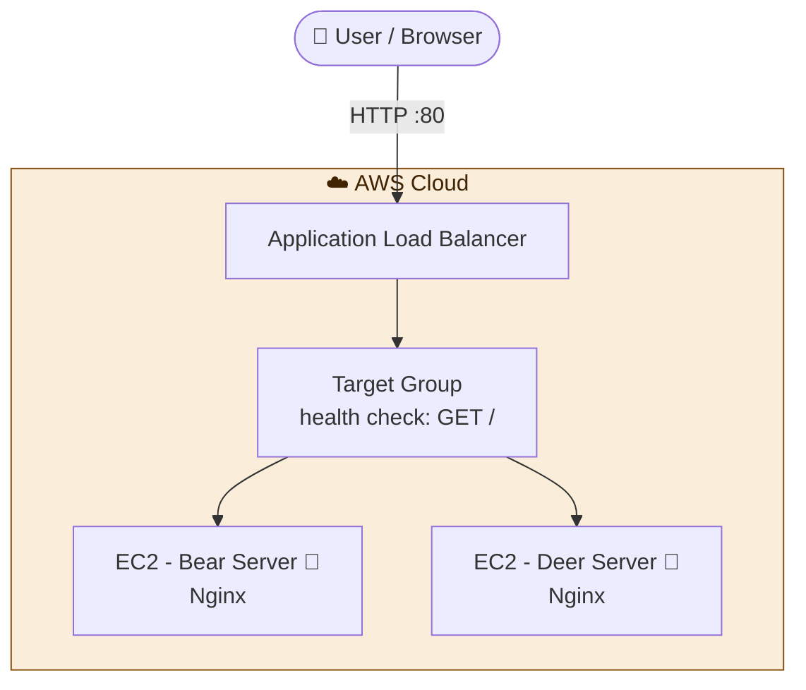

#  Cloud storage: AWS with Terraform

> Infrastructure as Code: an AWS Application that upload files to the s3 bucket , deployed with a single `terraform apply`.
>.


---

## 📖 Overview

This project uses **Terraform** to create everything needed to run a web cloud storage on AWS: an Application Load Balancer, a target group with health checks, security groups and two EC2 instances that running a docker image so you will have a GUI. 

Create a user and login then you can upload your files to the s3 bucket that were created in the AWS you will see the file upload and commper it to the s3 bucket in the aws platform .

**What this project covers:**

- Defining infrastructure as code with Terraform
- Provisioning a Auto scaling group, Load Balancer, target group, listener and health checks
- The auto scaling group keep two EC2 instances running if one file it will replase it and if there is a load it will open anther one up to 5 EC2
- Controlling access with security groups (public and private )
- Automating server setup with a shell script (`install.sh`)
- Exposing the application URL as a Terraform output by a LB DNS
- Clean teardown with `terraform destroy`

---

## 🏗️ Architecture



| Component | Role |
|-----------|------|
| **Application Load Balancer** | Public entry point, receives traffic on port 80 (http)|
| **Target Group** | Registers both servers and monitors their health |
| **EC2 instance ** |  server displaying GUI for uploading to s3 bucket  |
| **Auto scaling group | keep two instances running if one file it will replase it and if there is a load it will open anther one up to 5 EC2 |
| **Security groups** | Control which traffic can reach the load balancer and the servers |

---

## 🧰 Tech Stack

| Category        | Tools                                        |
|-----------------|----------------------------------------------|
| IaC             | Terraform                                    |
| Cloud Provider  | AWS (ALB, EC2, VPC, Security Groups)         |
| OS              | Ubuntu                                       |
| Web Server      | Nginx                                        |
| Scripting       | Bash (`scripts/install.sh`)                     |
| Version Control | Git & GitHub                                 |

---

## ✅ Prerequisites

| Requirement | Notes |
|-------------|-------|
| [Terraform](https://developer.hashicorp.com/terraform/install) `>= 1.5` | Verify with `terraform -version` |
| [AWS CLI](https://aws.amazon.com/cli/) | Configured with `aws configure` |
| AWS account | IAM user/role with EC2 and ELB permissions |

---

## 📁 Project Structure

?
---

## ⚙️ Configuration

Variables are defined in `variables.tf`:

| Variable        | Description                | Default     |
|-----------------|----------------------------|-------------|
| `aws_region`    | AWS region to deploy to    | `us-east-1` |
| `instance_type` | EC2 instance type          | `t2.micro`  |


---

## 🚀 Deployment

### 1. Clone the repository

```bash
git clone https://github.com/dolev225/DevOps-Project.git
cd "DevOps-Project/Cloude/DevOps-Project-04/terraform-deploy"
```


### 2. Authenticate with AWS

```bash
aws configure
# or export AWS_ACCESS_KEY_ID / AWS_SECRET_ACCESS_KEY / AWS_DEFAULT_REGION
```

### 3. Initialize Terraform

```bash
terraform init
```

### 4. Review the execution plan

```bash
terraform fmt -check
terraform validate
terraform plan
```

### 5. Apply

```bash
terraform apply
```

Type `yes` when prompted. When it finishes, Terraform prints the output:

```
Outputs:

URL = "http://<load-balancer-dns-name>"
```

### 6. Verify the load balancing

Wait 2-5 minutes for the servers to boot and pass health checks, then open the URL and **refresh several times**. The page alternates between the Bear and the Deer server.


### 7. Test  (optional)
---
Create a user and login then you can upload your files to the s3 bucket that were created in the AWS you will see the file upload and commper it to the s3 bucket in the aws platform .

---
## 🧹 Cleanup

The Application cost money while running. Destroy everything when you are done:

```bash
terraform destroy
```

Confirm with `yes`. Terraform removes all the resources it created.

---

## 🛠️ Troubleshooting

| Problem | Possible Solution |
|---------|-------------------|
| `No valid credential sources found` | Run `aws configure` or export AWS credentials |
| `UnauthorizedOperation` | The IAM user lacks EC2 / ELB permissions |
| `503 Service Temporarily Unavailable` | Targets are not healthy yet. Wait a few minutes and check the target group in the console |
| Page always shows the same server | Browser keep-alive. Try an incognito window or `curl` in a loop |
| Image does not appear | Check the image source used in `scripts/html.sh` is reachable |
| State lock / drift issues | Run `terraform refresh` or inspect with `terraform state list` |

Useful: check the bootstrap log on an instance with `sudo cat /var/log/cloud-init-output.log`.


