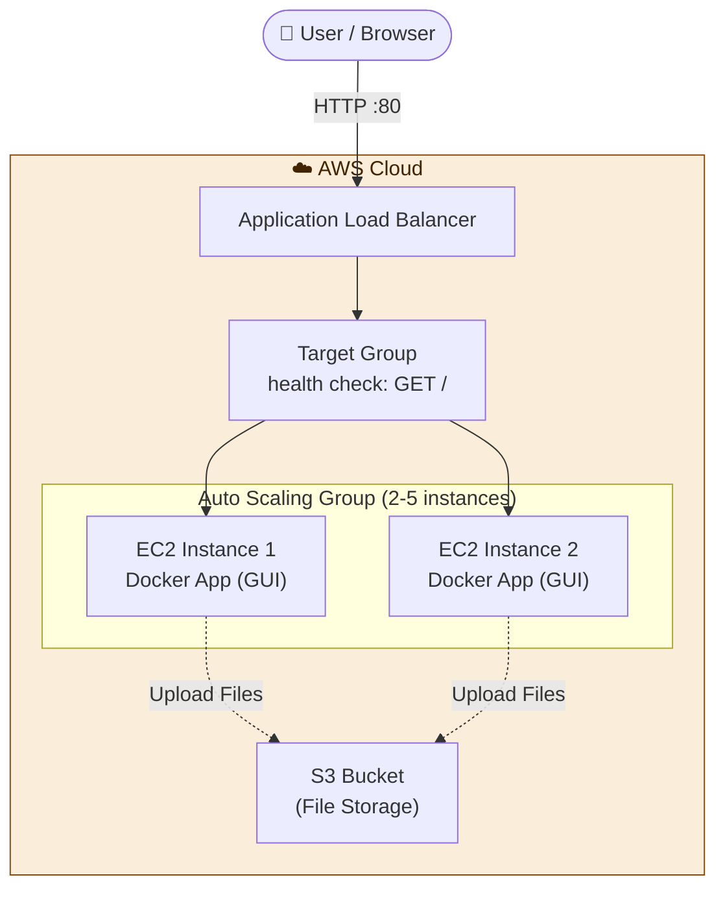

# Cloud storage: AWS with Terraform

> Infrastructure as Code: An AWS application that uploads files to an S3 bucket, deployed with a single `terraform apply`.


---

## 📖 Overview

This project uses **Terraform** to provision a complete cloud storage web application on AWS. It includes an Application Load Balancer, a target group with health checks, security groups, and an Auto Scaling Group managing EC2 instances running a Docker container with a user-friendly Web GUI.

Users can create an account, log in, and upload files through the web interface directly to an AWS S3 bucket, allowing you to easily view and compare uploaded files on both the frontend and the AWS S3 console.

**What this project covers:**
- Defining infrastructure as code using Terraform
- Provisioning an Application Load Balancer, Target Group, Listeners, and Health Checks
- Setting up an Auto Scaling Group (ASG) maintaining a minimum of 2 EC2 instances (scaling up to 5 under heavy load)
- Controlling network traffic with public and private Security Groups
- Automated server bootstrap and provisioning via a shell script (`install.sh`)
- Exposing the application via the Load Balancer DNS output
- Clean teardown with `terraform destroy`

---

## 🏗️ Architecture



| Component | Role |
| --- | --- |
| **Application Load Balancer** | Public entry point, distributing incoming HTTP traffic on port 80 |
| **Target Group** | Registers EC2 instances and monitors their health via HTTP health checks |
| **Auto Scaling Group (ASG)** | Maintains 2 running instances, automatically replacing failed ones and scaling up to 5 during high traffic |
| **EC2 Instances** | Run Docker containers providing the Web GUI for user management and file operations |
| **S3 Bucket** | Secure cloud storage repository holding the uploaded files |
| **Security Groups** | Act as virtual firewalls controlling traffic to the ALB and EC2 instances |

---

## 🧰 Tech Stack

| Category | Tools |
| --- | --- |
| IaC | Terraform |
| Cloud Provider | AWS (ALB, EC2, ASG, S3, VPC, Security Groups) |
| Containerization | Docker |
| OS | Ubuntu |
| Scripting | Bash (`scripts/install.sh`) |
| Version Control | Git & GitHub |

---

## ✅ Prerequisites

| Requirement | Notes |
| --- | --- |
| [Terraform](https://developer.hashicorp.com/terraform/install) `>= 1.5` | Verify with `terraform -version` |
| [AWS CLI](https://aws.amazon.com/cli/) | Configured with `aws configure` |
| AWS Account | IAM user/role with permissions for EC2, ELB, and S3 |

---

## 📁 Project Structure

```text
DevOps-Project/
└── Cloude/
    └── DevOps-Project-04/
        └── terraform-deploy/
            ├── main.tf          # Main infrastructure resources (ALB, ASG, S3, etc.)
            ├── variables.tf     # Input variables (aws_region, instance_type, etc.)
            ├── outputs.tf       # Output values (Load Balancer DNS URL)
            ├── provider.tf      # AWS provider and Terraform backend configuration
            └── scripts/
                └── install.sh   # User-data bootstrap script for EC2/Docker setup

```

---

## ⚙️ Configuration

Input variables are defined in `variables.tf`:

| Variable | Description | Default |
| --- | --- | --- |
| `aws_region` | AWS region to deploy resources | `us-east-1` |
| `instance_type` | EC2 instance type | `t2.micro` |

---

## 🚀 Deployment

### 1. Clone the repository

```bash
git clone [https://github.com/dolev225/DevOps-Project.git](https://github.com/dolev225/DevOps-Project.git)
cd "DevOps-Project/Cloude/DevOps-Project-04/terraform-deploy"

```

### 2. Authenticate with AWS

```bash
aws configure
# Or export AWS_ACCESS_KEY_ID / AWS_SECRET_ACCESS_KEY / AWS_DEFAULT_REGION

```

### 3. Initialize Terraform

```bash
terraform init

```

### 4. Review the execution plan

```bash
terraform fmt -check
terraform validate
terraform plan

```

### 5. Apply the configuration

```bash
terraform apply

```

Type `yes` when prompted. Once complete, Terraform will output the application URL:

```text
Outputs:

URL = "http://<load-balancer-dns-name>"

```

### 6. Verify and Test

1. Wait 2–5 minutes for the servers to finish booting and pass target group health checks.
2. Open the URL in your browser.
3. Create a user, log in, and upload a file through the GUI.
4. Verify that the file successfully appears in your AWS S3 bucket console.

---

## 🧹 Cleanup

Infrastructure incurs costs while running. Destroy all resources when finished:

```bash
terraform destroy

```

Confirm with `yes` to remove all created AWS resources.

---

## 🛠️ Troubleshooting

| Problem | Possible Solution |
| --- | --- |
| `No valid credential sources found` | Run `aws configure` or export your AWS credentials |
| `UnauthorizedOperation` | Ensure your IAM user has sufficient EC2, ELB, and S3 permissions |
| `503 Service Temporarily Unavailable` | Targets are still initializing. Wait a few minutes and check the Target Group health status in the AWS console |
| File upload fails | Check if the EC2 instance role has permissions to put/get objects from the S3 bucket |
| State lock / drift issues | Run `terraform refresh` or inspect with `terraform state list` |

> **Tip:** You can inspect bootstrap logs on an EC2 instance via SSH using: `sudo cat /var/log/cloud-init-output.log`

```

---

<ElicitationsGroup message="מה תרצה לעשות כעת עם הפרויקט?">
  <Elicitation label="הוספת הרשאות S3 ל-IAM Role" query="איך להגדיר IAM Role ו־Instance Profile בטראפורם כך שירותי ה־EC2 יורשו לגשת ל־S3 בצורה מאובטחת?"/>
  <Elicitation label="הוספת משתני סביבה מתקדמים" query="איך להעביר משתני סביבה דרך סקריפט ה־Bootstrap לקונטיינר ה־Docker?"/>
</ElicitationsGroup>

```
